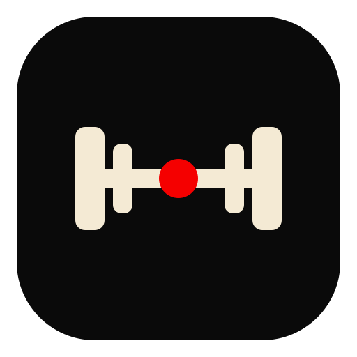
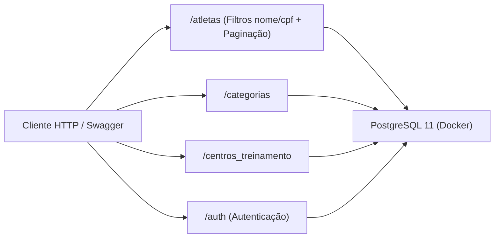

<a id="top"></a>

<div align="center">

<picture>
  <source media="(prefers-color-scheme: dark)" srcset="https://raw.githubusercontent.com/voaneves/workout_api/main/assets/brand/logo-dark.svg" />
  <source media="(prefers-color-scheme: light)" srcset="https://raw.githubusercontent.com/voaneves/workout_api/main/assets/brand/logo-light.svg" />
  
</picture>

<h1>WorkoutAPI</h1>

<p>
  <strong>API assíncrona em FastAPI para competições de CrossFit, com atletas, categorias, centros de treinamento, autenticação e paginação.</strong><br />
  <sub>
    Desafio do bootcamp Python / Back-End (DIO) —
    <kbd>Python 3.11+</kbd> · <kbd>FastAPI</kbd> · <kbd>SQLAlchemy 2</kbd> · <kbd>Alembic</kbd> · <kbd>PostgreSQL</kbd>
  </sub>
</p>

<p><sub>Precisa de uma API assíncrona bem estruturada? <a href="https://voaneves.com/#contato"><strong>Vamos conversar →</strong></a></sub></p>

<p>
  
  
  
  
</p>

<p>
  <a href="#sobre-o-projeto">Sobre</a> ·
  <a href="#modelo-de-dados">Modelo (MER)</a> ·
  <a href="#endpoints">Endpoints</a> ·
  <a href="#execucao-local">Como rodar</a> ·
  <a href="#contato">Contato</a>
</p>

</div>

<picture>
  <source media="(prefers-color-scheme: dark)" srcset="https://raw.githubusercontent.com/voaneves/workout_api/main/assets/brand/rule-dark.svg" />
  <source media="(prefers-color-scheme: light)" srcset="https://raw.githubusercontent.com/voaneves/workout_api/main/assets/brand/rule-light.svg" />
  
</picture>

<a id="sobre-o-projeto"></a>
## Sobre o projeto

Gerencie atletas, categorias e centros de treinamento de crossfit por uma API REST assíncrona em **FastAPI** com **SQLAlchemy 2**, **Pydantic v2** e migrações **Alembic** sobre **PostgreSQL**.

Desenvolvida como desafio prático de Back-End com Python na [DIO][dio], estendendo o projeto base com módulo de autenticação (`/auth`), filtros de consulta por `nome` e `cpf`, resposta customizada (`AtletaCustom`) e paginação com `fastapi-pagination`.

### Arquitetura e módulos



<dl>
  <dt><strong>Assincronismo nativo com <code>asyncpg</code></strong></dt>
  <dd>Rotas e serviços assíncronos conectados via <code>DatabaseDependency</code> sobre SQLAlchemy 2.0 e driver <code>asyncpg</code>.</dd>
  <dt><strong>Filtros &amp; projeção customizada em <code>/atletas</code></strong></dt>
  <dd>Consulta <code>GET /atletas/</code> com parâmetros opcionais <code>?nome=</code> e <code>?cpf=</code> retornando <code>Page[AtletaCustom]</code> (<code>nome</code>, <code>centro_treinamento</code> e <code>categoria</code>).</dd>
  <dt><strong>Migrações versionadas</strong></dt>
  <dd>Esquema relacional versionado em [`alembic/`](./alembic) e configurado via [`alembic.ini`](./alembic.ini).</dd>
</dl>

<a id="modelo-de-dados"></a>
## Modelagem entidade-relacionamento (MER)

<p align="center">
  
</p>

<a id="endpoints"></a>
## Rotas principais (`workout_api/routers.py`)

| Prefixo | Módulo | Recursos implementados |
| :--- | :--- | :--- |
| `/auth` | `workout_api/auth/` | Autenticação de usuários da API |
| `/atletas` | `workout_api/atleta/` | `POST`, `GET` paginado com filtros (`nome`, `cpf`), `GET /{id}`, `PATCH /{id}`, `DELETE /{id}` |
| `/categorias` | `workout_api/categoria/` | Cadastro e listagem de categorias de competição |
| `/centros_treinamento` | `workout_api/centro_treinamento/` | Cadastro e listagem de centros de treinamento |

<a id="execucao-local"></a>
## Como rodar localmente

```bash
git clone https://github.com/voaneves/workout_api.git
cd workout_api
pip install -r requirements.txt
docker compose up -d
make run-migrations
make run
```

Com a aplicação no ar, acesse a documentação interativa em `http://127.0.0.1:8000/docs`.

> [!TIP]
> Para gerar uma nova revisão de banco após alterar modelos, execute `make create-migrations d="nome_da_migration"` antes de `make run-migrations`. O [`docker-compose.yml`](./docker-compose.yml) sobe `postgres:11-alpine` com usuário, senha e banco `workout` na porta `5432`.

### Estrutura e referências

| Caminho | Descrição |
| :--- | :--- |
| [`workout_api/`](./workout_api) | Pacote principal (`main.py`, `routers.py`, `auth/`, `atleta/`, `categoria/`, `centro_treinamento/`) |
| [`alembic/`](./alembic) &amp; [`Makefile`](./Makefile) | Scripts de migração Alembic e atalhos `run` / `run-migrations` |
| [`requirements.txt`](./requirements.txt) | `fastapi==0.100.1`, `SQLAlchemy==2.0.19`, `alembic==1.11.1`, `asyncpg`, `pydantic==2.1.1`, `uvicorn` |

Referências oficiais: [FastAPI][fastapi] · [Pydantic][pydantic] · [SQLAlchemy][sqlalchemy] · [Alembic][alembic].

<a id="contato"></a>
## Contato

<p>
  <a href="https://voaneves.com/#contato"><strong>Vamos conversar →</strong></a> ·
  <a href="https://voaneves.com/"><strong>voaneves.com</strong></a> ·
  <a href="https://www.linkedin.com/in/voaneves/">LinkedIn</a> ·
  <a href="mailto:victorneves478@gmail.com">E-mail</a>
</p>

<div align="center">
  
</div>

<p align="center"><sub>© 2026 <a href="https://github.com/voaneves">Victor Neves</a> · <strong>VOANEVES.</strong></sub></p>

<p align="center"><sub><a href="#top">↑ Voltar ao topo</a></sub></p>

[dio]: https://www.dio.me/
[fastapi]: https://fastapi.tiangolo.com/
[pydantic]: https://docs.pydantic.dev/latest/
[sqlalchemy]: https://docs.sqlalchemy.org/en/20/
[alembic]: https://alembic.sqlalchemy.org/en/latest/
